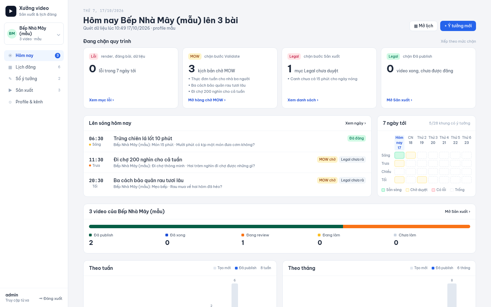
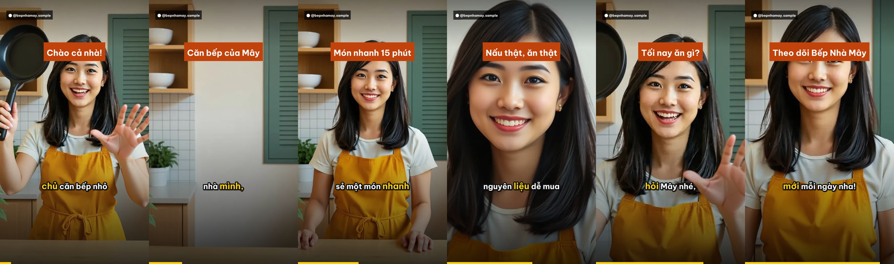
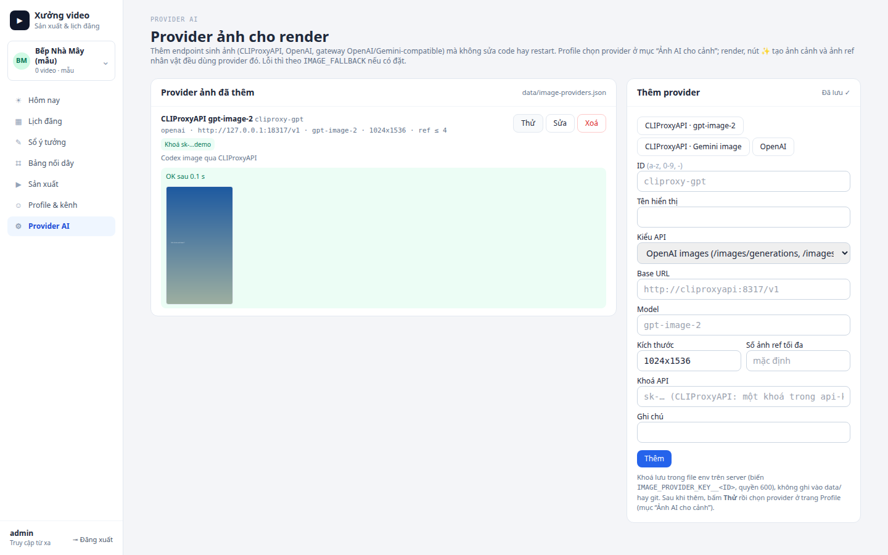
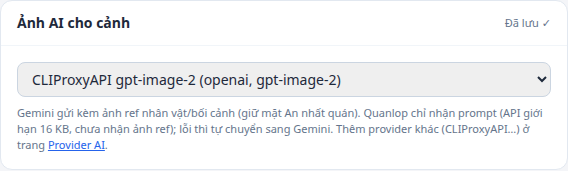

# Xưởng video — sản xuất & lịch đăng video ngắn

Web app quản lý một "xưởng" video ngắn 9:16 (TikTok, Reels, Shorts) theo từng kênh/nhân vật:
**hồ sơ kênh → sổ ý tưởng (AI) → duyệt MOW/Legal → sản xuất (TTS + phụ đề + render MP4) → lịch đăng → tự đăng**.

Toàn bộ dữ liệu là file JSON/Markdown trong `data/`, nên AI assistant (VD: Grok Bot) đọc/ghi được qua git
như một thành viên trong team.

> Profile **mẫu** `Bếp Nhà Mây (mẫu)` (cờ `sample: true`) dùng để thử; profile mẫu không bao giờ đăng thật hay nhận kết nối.
> Dữ liệu kênh thật của bạn cũng nằm trong `data/` (hoặc `DATA_DIR`). Thông tin vận hành từng kênh và máy chủ (lịch đăng, khoá riêng,
> VPS, domain) ghi ở `docs/kenh-dang-van-hanh.md`: file nội bộ, **không commit**, chỉ có trên máy vận hành.



## Tính năng

| Trang | Có gì |
|---|---|
| **Hôm nay** | Bài lên sóng hôm nay theo khung Sáng/Trưa/Chiều/Tối, 4 thẻ "đang chặn quy trình" (Lỗi, MOW, Legal, video xong chưa đăng), lưới 7 ngày × 4 khung, thanh trạng thái video, biểu đồ tuần/tháng |
| **Profile & kênh** | Thẻ kênh đăng (đồng bộ từ Zernio), Thông tin chung, Giọng văn, Giọng đọc TTS, Màu sắc, Hashtag: thêm/sửa/xoá; mỗi mục hiện `voice/<slug>.md:<dòng>` (file style guide tự sinh) |
| **Sổ ý tưởng** | AI sinh ý tưởng, AI viết kịch bản theo giọng kênh, quy trình `idea → script → mow → legal → production → ready → scheduled → published`, nút duyệt/trả lại kèm ghi chú, lịch sử |
| **Lịch đăng** | Lịch 7 ngày × 4 khung, kéo thả ý tưởng/video vào khung, kéo để đổi khung, gỡ khỏi lịch |
| **Sản xuất** | Mỗi video: sửa cảnh, upload ảnh/clip từng cảnh, chọn giọng, render MP4 9:16 (tiến độ realtime), xem video, duyệt, đăng ngay |
| **Provider AI** | Thêm/sửa/xoá provider sinh ảnh cho render ngay trên web (CLIProxyAPI, OpenAI, gateway OpenAI/Gemini-compatible), lưu khoá API an toàn, nút **Thử** sinh ảnh mẫu; profile chọn provider ở mục "Ảnh AI cho cảnh" |
| **Tự đăng** | `worker/publish.ts` quét lịch mỗi phút, đăng qua Zernio hoặc API trực tiếp (Facebook Reels, Instagram Reels, YouTube, TikTok), tự khai báo nội dung AI |

Mỗi kênh tự cấu hình khung giờ (`profile.slotTimes`), nền tảng và chế độ tự đăng (`data/autopublish.json`, chỉ video đã duyệt `done`;
profile phải có trong `AUTOPUBLISH_LIVE_PROFILES` mới đăng thật). Kênh cần duyệt nguồn đặt slug vào `EDITORIAL_PROFILE` và dùng thêm worker
`editorial-production` / `editorial-schedule` (bật/tạm dừng trên trang Lịch đăng). `PUBLISH_DRY_RUN=1` không được coi là đã đăng.

**Code không viết cứng kênh nào.** Hành vi riêng theo kênh đọc từ file env của máy chủ (`lib/channel-config.ts`):

| Biến | Ý nghĩa |
|---|---|
| `EDITORIAL_PROFILE` | Slug profile chạy luồng biên tập có nguồn: duyệt số liệu → kịch bản chỉ dùng số đã duyệt → MOW/Legal → render kiểm tra kỹ thuật → tối đa 2 khung/ngày (07:00, 11:30). Trống = tắt |
| `EDITORIAL_IDEA_GUIDE` | Câu hướng dẫn thêm khi AI sinh ý tưởng cho profile biên tập (VD các tuyến nội dung luân phiên) |
| `ZERNIO_DEDICATED_PROFILES` | Slug (phân tách dấu phẩy) bắt buộc dùng khoá `ZERNIO_API_KEY_<SLUG>`; thiếu khoá thì báo lỗi, không bao giờ dùng khoá chung |
| `AUTOPUBLISH_LIVE_PROFILES` | Slug được tự đăng thật |
| `SITE_OWNER`, `SITE_CHANNEL`, `SITE_FB_PAGE`, `SITE_VIDEO_KIND_VI`, `SITE_VIDEO_KIND_EN` | Nội dung trang công khai `/`, `/privacy`, `/terms` |
| `APP_IMAGE` | Tag image cho `docker-compose.tunnel.yml`, `docker-compose.autopublish.yml` (mặc định `video-studio:latest`) |

Câu kết/nhãn kênh để chạy `scripts/migrate-video-brand-cta.ts` nằm ở `data/brand-cta.json` (dữ liệu của bản triển khai).

## Nhận diện kênh, hook và câu kết

- **Nhãn kênh trên video**: `profile.brand` (VD "Bếp Nhà Mây"). Trống thì renderer dùng handle tài khoản kết nối đầu tiên, rồi tới `name`; handle có thể là ID trang Facebook nên kênh cần tên rõ phải đặt `brand` (PATCH `/api/profiles/<slug>` mục `meta`).
- **Hook**: câu đầu cảnh 1, vào thẳng vấn đề, không chào hỏi/giới thiệu kênh trước.
- **Câu kết**: mục Giọng văn tên đúng "Câu kết" là câu đọc nguyên văn cuối video. `writeScript` nối câu này vào lời cảnh cuối (sau lời giải/lưu ý), nên nó nằm trong kịch bản được duyệt chứ không chèn ngầm lúc render. Đổi câu kết chỉ áp dụng cho kịch bản viết sau; video cũ cập nhật bằng `npx tsx scripts/migrate-video-brand-cta.ts` (xem trước, `--apply` để ghi; bỏ qua video đã đăng/đang render, chạy lại không lặp câu).
- Sửa nội dung video chưa đăng (mọi kênh) đưa video về "Đang làm" và vô hiệu render cũ; phải render và duyệt lại trước khi lịch đăng nhận video.

## Nhân vật & bối cảnh cố định

Mỗi profile có mục **Nhân vật & bối cảnh** (`profile.cast.characters[]`, `profile.cast.settings[]`): tên, mô tả cố định
(gương mặt, tóc, trang phục / không gian, ánh sáng) và ảnh tham chiếu (upload hoặc "✨ Tạo ảnh AI"). Ảnh lưu ở
`data/assets/<slug>/` (commit vào git để AI assistant và mọi máy dùng chung).

- Mỗi ý tưởng/video chọn một nhân vật + một bối cảnh (`characterId`, `settingId`).
- AI viết kịch bản: prompt ảnh từng cảnh = hành động + `Same recurring character: <mô tả>` + `Same location: <mô tả>`.
- Tạo ảnh cảnh (nút ✨ trong Sản xuất, hoặc tự động khi render cảnh chưa có ảnh): gửi kèm ảnh ref nhân vật + bối cảnh
  nếu provider hỗ trợ (`openai` /images/edits, `xai` Grok Imagine, `hf-kontext`, `gemini` tối đa 4 ref), không thì prompt chữ có mô tả cố định.
- Mỗi cảnh chọn chuyển động: **Ken Burns** (zoom vào/ra, lia ngang/dọc) hoặc **image-to-video** (`VIDEO_PROVIDER=xai`, hoặc `veo` tuỳ chọn/trả phí, mặc định tắt). Ken Burns có ease in-out; biên độ chỉnh bằng `video.kbAmount` (mặc định 0.12, nên 0.05 cho cảm giác tự nhiên). `video.grain` (0 = tắt, 5–8 vừa) thêm hạt phim nhẹ. Clip được phóng lanczos lên 1080×1920.
- **Cảnh type "clip"**: `scene.clip` = file video (upload hoặc `assets/...`). Render cover-crop đầy 9:16, tắt tiếng clip, làm chậm nhẹ (tối đa `maxSlow`, mặc định 1.4×) hoặc giữ khung cuối cho khớp lời; trộn tự do với cảnh ảnh Ken Burns. Chuyển cảnh crossfade (`video.crossfade`, mặc định 0.35 s, 0 = cắt thẳng). Vị trí phụ đề/tiêu đề chỉnh bằng `captionY` (tỉ lệ chiều cao) và `titleY` (px), nhạc nền `musicVol`.
- Mẫu `vid-sample-10` "Trứng chiên 1 phút cùng Mây": 3 clip image-to-video trong `data/assets/mau-bep-nha-may/clips/` + 1 cảnh CTA ảnh tĩnh → `python3 worker/render.py --video vid-sample-10 --copy-to out/sample_may_motion.mp4`.
- Mẹo nhất quán: dùng 1 ảnh "nhân vật đứng trong bối cảnh" làm ảnh chính, các cảnh sau đều là bản *edit* từ ảnh đó.

Video mẫu `vid-sample-9` ("Chào cả nhà, mình là Mây") dùng nhân vật hư cấu **Mây** + bếp nhà Mây, ảnh tạo bằng
FLUX.1 [schnell] (ảnh chân dung gốc) rồi FLUX.1 Kontext [dev] (đặt vào bếp, các cảnh là bản edit từ ảnh chính).



## Provider ảnh AI trên giao diện (CLIProxyAPI…)

Trang **Provider AI** (`/provider`, menu trái) thêm provider sinh ảnh cảnh mà không sửa code, không sửa `.env` bằng tay, không restart.
Provider đã thêm dùng chung cho mọi đường sinh ảnh: render (`worker/render.py`, cảnh chưa có ảnh), nút ✨ tạo ảnh cảnh ở Sản xuất,
nút "✨ Tạo ảnh AI" của nhân vật/bối cảnh.



| Trường | Ý nghĩa |
|---|---|
| **ID** | `a-z`, `0-9`, `-` (2–31 ký tự), không trùng provider có sẵn (`gemini`, `quanlop`, `openai`, `xai`, `hf-kontext`). Không đổi được sau khi tạo |
| **Kiểu API** | `openai`: `POST {baseUrl}/images/generations` (chỉ prompt) và `POST {baseUrl}/images/edits` (multipart `image[]`, khi cảnh có ảnh ref nhân vật/bối cảnh). `gemini`: `POST {baseUrl}/models/<model>:generateContent` (ảnh ref gửi `inline_data`, tỉ lệ `9:16`) |
| **Base URL** | VD `http://cliproxyapi:8317/v1` (kiểu openai) hoặc `http://cliproxyapi:8317/v1beta` (kiểu gemini) |
| **Model** | VD `gpt-image-2`, `gpt-image-1.5`, `gemini-3.1-flash-image` |
| **Kích thước** | Chỉ kiểu openai, mặc định `1024x1536` (dọc). Renderer cắt cover về 1080×1920 |
| **Số ảnh ref tối đa** | `0` = chỉ gửi prompt; trống = mặc định (openai 16, gemini 4) |
| **Khoá API** | Ghi vào file env trên server (`ENV_FILE`, mặc định `.env`) thành biến `IMAGE_PROVIDER_KEY__<ID>` (VD `IMAGE_PROVIDER_KEY__CLIPROXY_GPT`), quyền `0600`, sao lưu `.env.bak`. Giao diện/API chỉ trả dạng che `sk-…abcd`. Để trống khi sửa = giữ khoá cũ; có ô "Xoá khoá đã lưu". Provider không cần khoá (CLIProxyAPI không đặt `api-keys`) thì bỏ trống |

Cách dùng:

1. Mở **Provider AI** → bấm mẫu **CLIProxyAPI · gpt-image-2** (hoặc **CLIProxyAPI · Gemini image**, **OpenAI**) → sửa Base URL, dán khoá → **Thêm**.
2. Bấm **Thử**: sinh 1 ảnh mẫu (không dùng dự phòng, để thấy đúng lỗi của provider: sai URL, 401 sai khoá, model không có…). Ảnh thử lưu ở `media/provider-test/`.
3. Mở **Profile & kênh** → mục **Ảnh AI cho cảnh** → chọn provider vừa thêm. Từ đây render và các nút ✨ của profile dùng provider này.



- Cấu hình (không bí mật) lưu ở `data/image-providers.json` nên AI assistant và mọi máy đọc được qua git; **khoá không bao giờ nằm trong `data/`**.
- `worker/media_gen.py` đọc `data/image-providers.json` và khoá mỗi lần sinh ảnh (khoá đọc lại từ `ENV_FILE` trước, rồi tới biến môi trường), nên provider/khoá vừa lưu có hiệu lực ngay với cả container render khác (`editorial-production` mount thư mục env ở `/env`, chỉ đọc).
- Không xoá được provider khi còn profile dùng nó (đổi provider ở trang Profile trước). Xoá provider cũng xoá khoá khỏi file env.
- Dự phòng vẫn theo `IMAGE_FALLBACK` (có thể ghi ID provider tự thêm, VD `IMAGE_FALLBACK=cliproxy-gemini,gemini`).
- CLI: `python3 worker/media_gen.py image --provider cliproxy-gpt --prompt "..." --out a.png [--ref r.png]`.

### Dựng CLIProxyAPI làm provider ảnh

[CLIProxyAPI](https://github.com/router-for-me/CLIProxyAPI) là proxy biến tài khoản Codex/ChatGPT, Gemini… (đăng nhập OAuth hoặc API key)
thành API OpenAI-compatible. Từ v6.9.30 có `/v1/images/generations` và `/v1/images/edits` (model `gpt-image-2`, `gpt-image-1.5`,
`gemini-3.1-flash-image`…). Dùng **v7.2.17 trở lên**: v7.0.x định tuyến sai `gpt-image-2` trên endpoint ảnh và trả 502
([issue #3314](https://github.com/router-for-me/CLIProxyAPI/issues/3314)).

**1. Cấu hình** (thư mục bí mật ngoài repo, VD `<SECRETS_DIR>/cliproxyapi`, quyền `0700`):

```bash
export CLIPROXY_DIR=<SECRETS_DIR>/cliproxyapi
mkdir -p $CLIPROXY_DIR/auths $CLIPROXY_DIR/logs && chmod 700 $CLIPROXY_DIR
curl -fsSL https://raw.githubusercontent.com/router-for-me/CLIProxyAPI/main/config.example.yaml -o $CLIPROXY_DIR/config.yaml
chmod 600 $CLIPROXY_DIR/config.yaml
openssl rand -hex 24      # dùng làm khoá client, dán vào access.api-keys
```

Sửa trong `config.yaml` (giữ nguyên phần còn lại của file mẫu):

```yaml
server:
  port: 8317
access:
  api-keys:
    - "<khoá client vừa tạo>"     # video-studio gửi Authorization: Bearer <khoá này>
multimedia:
  disable-image-generation: false  # để bật /v1/images/*
```

**2. Chạy cạnh app** bằng `docker-compose.cliproxy.yml` (image `eceasy/cli-proxy-api`, chỉ bind `127.0.0.1:8317`, cùng mạng Docker với `web`):

```bash
export APP_ENV_DIR=<SECRETS_DIR>/env TUNNEL_CONFIG_DIR=<SECRETS_DIR>/cloudflared
export CLIPROXY_DIR=<SECRETS_DIR>/cliproxyapi
COMPOSE="docker compose -f docker-compose.yml -f docker-compose.tunnel.yml -f docker-compose.autopublish.yml -f docker-compose.cliproxy.yml"
$COMPOSE up -d cliproxyapi
```

**3. Đăng nhập tài khoản upstream** (VD Codex, token lưu ở `$CLIPROXY_DIR/auths`). Đăng nhập OAuth cần trình duyệt mở callback
`localhost:1455`; trên VPS, mở SSH tunnel từ máy mình rồi chạy lệnh login trong container (cờ chính xác xem README CLIProxyAPI):

```bash
ssh -L 1455:127.0.0.1:1455 <user>@<vps>                    # máy cá nhân
$COMPOSE exec cliproxyapi ./CLIProxyAPI --codex-login --no-browser   # trên VPS, mở URL in ra
```

Hoặc dùng Gemini API key / management panel theo tài liệu CLIProxyAPI.

**4. Kiểm tra** trên VPS:

```bash
curl -s http://127.0.0.1:8317/v1/models -H "Authorization: Bearer <khoá client>" | grep -o '"id":"[^"]*image[^"]*"'
curl -s http://127.0.0.1:8317/v1/images/generations -H "Authorization: Bearer <khoá client>" \
  -H "Content-Type: application/json" -d '{"model":"gpt-image-2","prompt":"a red apple","size":"1024x1536","n":1}' | head -c 200
```

**5. Thêm vào app**: trang **Provider AI** → mẫu **CLIProxyAPI · gpt-image-2**, Base URL `http://cliproxyapi:8317/v1`
(app chạy ngoài Docker: `http://127.0.0.1:8317/v1`), khoá = khoá client ở bước 1 → **Thêm** → **Thử** → chọn ở Profile.

## Cài đặt

Yêu cầu: Node 20+, Python 3.10+, ffmpeg, font **Be Vietnam Pro** (hoặc đặt `FONT_NAME`).

```bash
git clone https://github.com/trungsin/video-studio && cd video-studio
npm install
pip install edge-tts numpy pillow gradio_client     # gradio_client chỉ cần nếu dùng VieNeu
cp .env.example .env                                 # sửa ADMIN_PASSWORD, SESSION_SECRET...
npx tsx scripts/seed.ts --reset                      # (tuỳ chọn) làm mới dữ liệu mẫu theo ngày hôm nay
npm run dev                                          # http://localhost:3100
```

Production: `npm run build && npm start`. Đăng bài tự động: `npm run publish:watch` (hoặc cron mỗi phút `npm run publish:once`).

## Render v3 (nâng cấp từ skill tts-motion-video)

Module dùng chung nằm ở `worker/mvlib/` (vendor từ `/workspace/motion-video`, đồng bộ bằng `sh scripts/sync-mvlib.sh`).

- **Giọng đọc**: engine `vieneu` chạy **VieNeu-TTS v3 Turbo local trên CPU**. Nếu worker không cài thì dùng Gradio (`VIENEU_GRADIO_URL`, URL app Gradio VieNeu của bạn), sau cùng là edge-tts. Giọng chọn theo profile (`profile.tts`); các video đã tạo lưu cấu hình TTS riêng nên cần đổi giọng và render lại để áp dụng. Giọng không có mốc từng từ được căn bằng **faster-whisper** (`tts.align`: `auto`/`on`/`off`, mặc định auto). Giọng chuẩn hoá về -16 LUFS (`video.loudnorm=false` hoặc `LOUDNORM=0` để tắt).
- **Chống giọng bị cắt**: edge-tts phải trả ≥ 85% số từ của lời đọc (bình thường ≥ 97%), kể cả bản lấy từ cache (cache thiếu lời bị xoá và đọc lại); cụm VieNeu Gradio ≥ 4 âm tiết đọc nhanh hơn 9 âm tiết/giây coi là bị cắt và đọc lại. Thử 3 lần vẫn thiếu thì VieNeu chuyển sang edge-tts, edge-tts thì render báo lỗi, không xuất MP4 thiếu lời (`MIN_WORD_RATIO`, `MAX_SYLLABLES_PER_SEC` trong `worker/render.py`).
- **Chuẩn hoá chữ**: số, %, đơn vị, ngày, giờ, phân số được đọc thành chữ, phụ đề vẫn giữ chữ gốc. Từ điển phát âm: `worker/mvlib/pronounce.txt` + `data/pronounce.txt` (team tự sửa, dạng `TTS => tê tê ét`). Chèn ngắt nghỉ trong lời đọc: `[pause]` hoặc `[pause 0.6]`.
- **Phụ đề/tiêu đề**: cụm tối đa 4 từ và vừa 1 dòng, cỡ 90 px, chừa cột nút bên phải, không thấp hơn 75% khung. Tiêu đề tự thu nhỏ hoặc xuống 2 dòng. **Tránh khuôn mặt** (OpenCV YuNet, ảnh tĩnh và 6 khung lấy mẫu của clip): tiêu đề chuyển xuống dưới mặt, phụ đề sang dải trống (`video.faceAware=false` để tắt). Vị trí đã chọn ghi vào `out/<id>.timeline.json`.
- **Kiểm tra nhân vật**: so khuôn mặt từng cảnh (ảnh và clip) với ảnh chân dung trong `cast.characters[].refs` (hoặc `portrait`) bằng SFace, ngưỡng 0.363 (`driftThreshold`). Kết quả ghi vào `render.drift` và `out/<id>.drift.json`, cảnh lệch được ghi vào log (`video.driftCheck=false` để tắt).
- **Thẻ động** (tuỳ chọn): `scene.chart` = `{type: bar|hbar|line|donut|kpi|terminal, caption, labels, values, lines, highlight}` phủ giữa khung. Terminal tự thu nhỏ chữ, ngắt dòng và cuộn.
- **Tốc độ**: dựng các cảnh song song, file trung gian ultrafast, bản cuối veryfast (`RENDER_PRESET`), cache edge/VieNeu ở `media/cache/tts`.
- Cài đặt worker: `pip install -r worker/requirements.txt && python3 worker/fetch_models.py --all` (chỉ cần model khuôn mặt thì bỏ `--all`). Có thể đặt `PYTHON_BIN` trỏ tới một venv. Env: `TTS_ENGINE_OVERRIDE=vieneu` (ép mọi video dùng VieNeu), `VIENEU_VOICE`, `VIENEU_LOCAL=0`, `TTS_ALIGN`, `ALIGN_MODEL`, `MV_MODELS_DIR`.
- `media_gen.py image --character data/profiles/<slug>.json#<characterId> --prompt "..."` thêm mô tả cố định và ảnh ref của nhân vật vào prompt.

## Biến môi trường

| Biến | Bắt buộc | Ý nghĩa |
|---|---|---|
| `ADMIN_PASSWORD` | ✔ | Mật khẩu đăng nhập |
| `SESSION_SECRET` | ✔ | Chuỗi ngẫu nhiên ký cookie (`openssl rand -hex 32`) |
| `CRON_SECRET` | | Cho phép `POST /api/publish/run` với `Authorization: Bearer <CRON_SECRET>` |
| `DATA_DIR`, `MEDIA_DIR` | | Mặc định `./data`, `./media` |
| `MYCDN_API_KEY__<SLUG>`, `MYCDN_URL` | | Token myCDN riêng từng profile (VD `MYCDN_API_KEY__BEP_NHA_MAY` cho slug `bep-nha-may`), `MYCDN_URL` = địa chỉ CDN của bạn (bắt buộc; trống thì tắt CDN). Service `cdn-sync` (`worker/cdn-sync.ts --watch`, `--dry-run`, `--profile <slug>`) đẩy MP4 + ảnh cảnh ngay khi render xong (theo dõi `data/videos`), mỗi phút quét thêm ảnh/clip cảnh, ảnh tư liệu, `data/assets/<slug>`; `/api/media`, `/api/assets`, `/api/thumb` chuyển hướng 302 sang CDN (URL công khai). Đăng bài: Zernio nhận URL CDN, Facebook/Instagram Reels dùng header `file_url` (nền tảng tự tải từ CDN); YouTube và TikTok trực tiếp chỉ nhận byte nên gửi file local cùng nội dung. CDN lỗi thì đăng bằng file local. Không có key: phục vụ và đăng từ local |
| `TZ_OFFSET` | | Múi giờ khung đăng, mặc định `+07:00` |
| `LLM_BASE_URL`, `LLM_API_KEY`, `LLM_MODEL` | | Endpoint OpenAI-compatible (OpenAI, xAI, OpenRouter, CLIProxyAPI, Ollama…). Chưa đặt → chế độ "mẫu" |
| `IMAGE_PROVIDER` | | `openai` \| `xai` \| `hf-kontext` \| `gemini` \| `quanlop` \| `none` \| ID provider tự thêm. Chưa đặt → nền gradient theo màu thương hiệu |
| `IMAGE_PROVIDER_KEY__<ID>` | | Khoá API của provider thêm trên trang **Provider AI** (giao diện tự ghi, không cần đặt tay) |
| `ENV_FILE` | | File env mà giao diện ghi khoá (YouTube, Instagram, provider ảnh). Mặc định `.env`; Docker: `/env/.env` |
| `IMAGE_BASE_URL`, `IMAGE_API_KEY`, `IMAGE_MODEL`, `IMAGE_SIZE` | | Cho `openai` (OpenAI, Pollinations gen API, gateway tương thích) |
| `XAI_API_KEY` | | Cho `xai` (ảnh + video Grok Imagine) |
| `HF_TOKEN` | | Cho `hf-kontext` (thêm quota ZeroGPU) |
| `GEMINI_API_KEY` | | Cho `gemini` (Gemini API, model mặc định `gemini-3.1-flash-image`, đổi bằng `IMAGE_MODEL`; ảnh ref gửi inline, tối đa 4) |
| `IMAGE_ASPECT` | | Tỉ lệ ảnh cho `gemini`, mặc định `9:16` (video/cảnh có thể đặt `aspect`) |
| `VIDEO_PROVIDER`, `VIDEO_MODEL` | | Image-to-video theo cảnh (`xai`, `veo`). Mặc định tắt → Ken Burns. `veo` (Gemini API, `GEMINI_API_KEY`) là **tuỳ chọn và trả phí** (~$0.05–0.10/giây) |
| `TTS_QC_GEMINI` | | `1` bật / `0` tắt bước **Gemini nghe kiểm tra** giọng VieNeu (mặc định theo `profile.ttsQc.gemini`). Gửi audio từng cảnh + câu kỳ vọng tới Gemini Flash (audio input), nhận JSON từng câu: đọc sai, sai thanh điệu, méo, thiếu/thừa từ, ngắt nghỉ lạ, tiếng robot (mốc giây + độ tin cậy). Câu sai bị sinh lại (`TTS_QC_GEMINI_ROUNDS`, mặc định 2), còn sai thì ghi vào `.ttsqc.json`. Model `TTS_QC_GEMINI_MODEL` (mặc định `gemini-3.5-flash-lite`, ≈$0.005/video 45 s), ngưỡng `TTS_QC_GEMINI_MIN_CONF` (0.7). Token + chi phí ghi vào log và `<out>.gemini-usage.json`. Lỗi API (hết credit…) chỉ ghi log, không làm hỏng render. CLI: `python worker/gemini_listen.py --video vid-xx` |
| `VIENEU_GRADIO_URL` | | Gradio app VieNeu-TTS (giọng "Ngọc Huyền"…). Lỗi → tự quay về edge-tts |
| `PUBLISH_DRY_RUN` | | `1` = chạy adapter thật với fetch mô phỏng: in ra từng request (token thay bằng `<TÊN_BIẾN>`), không gọi mạng |
| `AI_DISCLOSURE`, `AI_DISCLOSURE_TEXT` | | Khai báo nội dung AI, mặc định **bật** (`0` để tắt). Bật cờ AI của từng nền tảng và thêm dòng `AI_DISCLOSURE_TEXT` (mặc định "Nội dung minh họa có sử dụng AI.") vào caption. Ghi đè theo profile `aiDisclosure: {enabled, text}` hoặc theo video `aiDisclosure: true/false` |
| `ZERNIO_API_KEY`, `ZERNIO_BASE_URL` | | Đăng qua [Zernio](https://docs.zernio.com) (xem mục *Thiết lập Zernio (TikTok)*) |
| `ZERNIO_POLL_INTERVAL_MS`, `ZERNIO_POLL_TIMEOUT_MS`, `ZERNIO_TIKTOK_DRYRUN` | `10000`, `600000`, `1` | Chu kỳ / thời gian tối đa chờ trạng thái bài Zernio; `ZERNIO_TIKTOK_DRYRUN=0` bỏ bước kiểm tra `dryRun` trước khi đăng TikTok. `ZERNIO_URL_WAIT_MS` (mặc định `120000`): thời gian chờ thêm để lấy link bài sau khi đã published |
| `FB_PAGE_ID`, `FB_PAGE_TOKEN`, `FB_GRAPH_VERSION` | | Facebook Page Reels (mặc định `v26.0`). Token: Page access token có `pages_show_list`, `pages_read_engagement`, `pages_manage_posts` |
| `FB_REELS_STATE`, `FB_UPLOAD_RETRIES`, `FB_POLL_INTERVAL_MS`, `FB_POLL_TIMEOUT_MS` | | Tuỳ chọn: `PUBLISHED`/`DRAFT`, số lần gửi tiếp khi upload đứt (3), chu kỳ/thời hạn chờ xử lý (5s/10 phút) |
| `IG_USER_ID`, `IG_ACCESS_TOKEN` | | Instagram Reels trực tiếp. `IG_USER_ID` = Instagram Business/Creator account id (từ `GET /{page-id}?fields=instagram_business_account`); token từ **Facebook Login for Business** có `instagram_basic`, `instagram_content_publish`, `pages_read_engagement` (bắt buộc để dùng upload resumable) |
| `IG_GRAPH_VERSION`, `IG_GRAPH_HOST`, `IG_SHARE_TO_FEED`, `IG_UPLOAD_RETRIES`, `IG_POLL_INTERVAL_MS`, `IG_POLL_TIMEOUT_MS` | | Tuỳ chọn (mặc định `FB_GRAPH_VERSION`/v26.0, `graph.facebook.com`, `1`, 2, 30s, 10 phút) |
| `YT_CLIENT_ID`, `YT_CLIENT_SECRET`, `YT_REFRESH_TOKEN`, `YT_PRIVACY`, `YT_CATEGORY_ID`, `YT_LANGUAGE` | | Đăng YouTube (Data API v3). Mặc định `private`, category `27` (Education), ngôn ngữ `vi` |
| `TIKTOK_ACCESS_TOKEN`, `TIKTOK_PRIVACY` | | Đăng TikTok (Content Posting API) |

**Không bao giờ commit `.env`** (đã nằm trong `.gitignore`). `media/` (upload + video render) cũng không commit.

## Cấu trúc dữ liệu (`data/`)

```
data/
  profiles/<slug>.json     # hồ sơ kênh: channels, tts, slotTimes, sections{info,voice,ttsNotes,colors,hashtags}
  voice/<slug>.md          # style guide sinh tự động từ profile (ref file:line hiện trên UI) — đừng sửa tay
  ideas/<id>.json          # ý tưởng + kịch bản (script.scenes[] {title,narration,visual}) + review + history
  videos/<id>.json         # job sản xuất: scenes (+image), tts, render{state,progress,log,output}, publish[]
  schedule.json            # {entries:[{date,slot,time,ideaId,videoId,platforms,status,results}]}
```

Trạng thái ý tưởng: `idea → script → mow → legal → production → ready → scheduled → published` (+ `rejected`).
Khi Legal duyệt, app tự tạo `videos/<id>.json`. Render xong → video `review`; duyệt → `done` + ý tưởng `ready`.
Kéo vào lịch → `scheduled`. Worker đăng xong → `published`.

## AI assistant tích hợp thế nào

AI assistant (Grok Bot) làm việc trực tiếp trên repo này:

1. **Đọc ngữ cảnh**: `data/profiles/<slug>.json` + `data/voice/<slug>.md` để viết đúng giọng kênh.
2. **Viết ý tưởng/kịch bản**: tạo `data/ideas/idea-<...>.json` với `status: "script"` và `script.scenes`, commit + push.
   Hoặc gọi API (`POST /api/ideas/generate`, `POST /api/ideas/<id>/script`) nếu app có LLM.
3. **Người duyệt** trên web (MOW, Legal) — AI không tự duyệt thay người.
4. **Sản xuất**: chạy `python3 worker/render.py --video <id>` (hoặc `POST /api/videos/<id>/render`), kiểm tra
   `media/out/<id>.mp4` + `<id>.timeline.json`, báo lại.
5. **Lên lịch**: thêm entry vào `data/schedule.json` (hoặc `POST /api/schedule {ideaId,date,slot}`).
6. **Đăng**: `worker/publish.ts` tự làm khi đến giờ; AI chỉ theo dõi `results` trong schedule.

Mọi API đều cần cookie đăng nhập, riêng `/api/publish/run` nhận `Bearer CRON_SECRET`.
Khi web và git cùng ghi `data/`, nên để server tự `git pull --rebase && git commit && git push` theo cron
(VD 5 phút/lần) để AI và web không đè nhau.

## Render video (`worker/render.py`)

- TTS từng cảnh: **edge-tts** (vi-VN-HoaiMyNeural / vi-VN-NamMinhNeural, có mốc thời gian từng từ) hoặc **VieNeu** (Gradio, đồng bộ theo cụm câu).
- Hình: ảnh upload hoặc `data/assets/...` (Ken Burns: zoom vào, lia ngang, zoom ra, lia dọc), clip upload (cắt/lặp cho khớp), ảnh AI có ref nhân vật/bối cảnh (`worker/media_gen.py`), image-to-video (tuỳ chọn) hoặc nền gradient màu thương hiệu kèm ghi chú "Ảnh minh hoạ: …". Ảnh/clip AI sinh ra được ghi lại vào job để render lại không tốn thêm lượt.
- Chữ: tiêu đề động (pop + trượt), phụ đề cụm ≤ 4 từ, **từ đang đọc đổi màu + phóng to**, chip tên kênh, thanh tiến độ.
- Âm thanh: giọng + nhạc nền tự tổng hợp (không bản quyền), tự giảm khi có lời.
- Ra `media/out/<id>.mp4` (1080×1920, H.264/AAC, faststart) + ảnh thumbnail + timeline JSON.

```bash
python3 worker/render.py --video vid-sample-1 --copy-to out/sample.mp4
```

## Ảnh tư liệu lịch sử (`worker/archive.py`, `data/archive/`)

Cảnh nói về sự kiện/di tích dùng ảnh thật từ Wikimedia Commons, chỉ nhận **Public domain / CC0 / CC BY / CC BY-SA** (loại NC, ND, fair use, ảnh báo chí/stock). Thư viện dùng lại được: `data/archive/<topic>/<slug>.jpg` + `index.json` (URL trang, tác giả, giấy phép, sha1, từ khoá) + `CREDITS.md`.

```bash
python3 worker/archive.py search "Cửu Đỉnh Huế"                          # tìm trên Commons (đã lọc giấy phép)
python3 worker/archive.py add --topic cuu-dinh "File:Nine Dynastic Urns, Hue (27767078029).jpg" --slug cuu-dinh-hang-dronepicr
python3 worker/archive.py fetch --topic cuu-dinh --query "cửu đỉnh huế" --n 3             # thư viện trước, thiếu thì tải + cache
python3 worker/archive.py credits --video <video-id>                      # dòng ghi công cho caption
```

Trong kịch bản, cảnh có `"archive": {"items": [{"id": "cuu-dinh/ho-cao-dinh", "label": "Hổ · đúc nổi trên Cao Đỉnh", "mode": "detail", "focus": [0.5, 0.45]}]}` (hoặc `{"query": "...", "topic": "..."}` để tự tìm theo từ khoá). `mode`: `frame` (ảnh đóng khung trên nền mờ, parallax), `detail` (cận cảnh full-bleed zoom vào `focus`), `pan`, `backdrop` (nền tối cho thẻ số liệu). Nhãn Noto Serif + dòng ghi công nằm ngoài vùng tiêu đề/phụ đề. Render ghi `credits` + `archiveCredits` vào video; `buildCaption` luôn chèn dòng `📷 Ảnh tư liệu: …` và Threads (500 ký tự) cắt phần thân nhưng giữ dòng này.

Kênh có nhân vật dẫn chuyện cố định nên dùng lại clip/ảnh đã có (`clip: "assets/<profile>/<thư-mục>/clips/01-hook.mp4"`, `clipStart`) thay vì sinh mặt mới; cảnh mới dẫn xuất từ ảnh nhân vật có sẵn (image-to-video).

## Đăng bài (`lib/publishers/`)

| Adapter | Trạng thái |
|---|---|
| `zernio.ts` | docs.zernio.com: `POST /v1/media/presign` → PUT file (stream) → `POST /v1/posts` (`publishNow`, `Idempotency-Key`) → poll `GET /v1/posts/{id}` tới `published`/`failed`. TikTok: `creator-info` → kiểm tra quyền riêng tư/giới hạn → `POST /v1/posts {dryRun:true}` (`canPublish`) → đăng với `tiktokSettings` do người dùng chọn. Cờ AI: YouTube `containsSyntheticMedia`, Instagram `isAiGenerated`, TikTok `tiktokSettings.video_made_with_ai`; Facebook đăng dạng `contentType: "reel"` (Zernio chưa có cờ AI cho Facebook, chỉ có dòng khai báo trong caption). **Chưa chạy với key thật.** |
| `facebook.ts` | **Page Reels API** v26.0: `video_reels` start → `rupload` (stream, gửi tiếp từ `bytes_transfered` khi đứt) → finish (`description`, `title`, `is_ai_generated`, tuỳ chọn `scheduled_publish_time`) → poll `?fields=status` đến khi đăng xong/lỗi. Chỉ đăng lên Page của chính mình thì Standard Access là đủ (admin của app). **Chưa chạy với token thật.** |
| `instagram.ts` | **Instagram Reels**: container `media_type=REELS, upload_type=resumable, is_ai_generated` → `rupload.facebook.com/ig-api-upload` (không cần URL công khai) → poll `status_code` → `media_publish` → permalink. Giới hạn 100 bài/24h. **Chưa chạy với token thật.** |
| `youtube.ts` | Data API v3 resumable upload (stream), refresh token, `status.containsSyntheticMedia`. Video dọc ≤ 3 phút thành Shorts. **Chưa chạy với token thật.** |
| `tiktok.ts` | Content Posting API (Direct Post, FILE_UPLOAD 1 chunk ≤ 64MB), `is_aigc`. App chưa audit chỉ đăng `SELF_ONLY` lên tài khoản private. TODO: OAuth/refresh, nhiều chunk, poll trạng thái. **Chưa chạy với token thật.** |
| `dryrun.ts` + `simulate.ts` | `PUBLISH_DRY_RUN=1`: chạy adapter thật với fetch mô phỏng, in request, không gọi mạng |

Kiểm thử: `npm test` (fetch giả, chặn mạng). Xem trước request cho một video: `npm run publish:dryrun -- <video-id> [facebook instagram youtube tiktok] [--zernio]` (không sửa data).

Chọn adapter: (dry-run mô phỏng chính adapter sẽ được chọn) → kênh `via: "direct"` → Zernio (nếu kênh có `accountId`) → adapter trực tiếp đã cấu hình.

## Thiết lập Zernio (TikTok)

TikTok không cấp quyền Direct Post cho app tự dùng, nên kênh TikTok đăng qua [Zernio](https://zernio.com) (2 tài khoản đầu miễn phí).

1. **Tạo API key**: đăng ký zernio.com → Dashboard → *API Keys* → tạo key, rồi ghi vào `.env` (không commit):
   ```
   ZERNIO_API_KEY=sk_...
   ```

2. **Kết nối TikTok** trong Dashboard Zernio (*Accounts → Connect → TikTok*), đăng nhập tài khoản TikTok của kênh. Kết nối qua *TikTok for Business* thì đăng thẳng **chỉ được Công khai**; muốn chế độ khác thì bật *Gửi bản nháp*.
3. **Lấy account ID**: khởi động lại app (`sh scripts/serve.sh stop && sh scripts/serve.sh start`), mở *Profile & kênh* → bấm **⟳ Tải lại** ở thẻ kênh. App gọi `GET /v1/accounts` và ghi `via: "zernio"`, `accountId` vào kênh TikTok trong `data/profiles/<slug>.json`. Không cần nhập ID bằng tay. Lưu ý: nền tảng nào kết nối trên Zernio sẽ đăng qua Zernio. Facebook đang đăng trực tiếp (Graph API, có cờ AI riêng), nên **đừng kết nối Facebook trên Zernio**, hoặc đặt `"via": "direct"` cho kênh facebook.
4. **Đăng một video** (trang *Sản xuất → video*, mục *Duyệt & đăng*, tick `tiktok`):
   - App tải *creator info* của tài khoản (nickname, quyền riêng tư cho phép, tương tác bị tắt, thời lượng tối đa).
   - **Quyền riêng tư không có mặc định**: bạn phải tự chọn.
   - Bình luận / Duet / Stitch mặc định **tắt**; ô nào bị tài khoản tắt thì bị khoá.
   - Tiết lộ nội dung thương mại (mặc định *Không*; *Paid partnership* không được để *Chỉ mình tôi*).
   - *Gửi bản nháp*: video vào hộp thư TikTok (app TikTok ≥ 31.8, tối đa 5 bản nháp/24h), bạn tự bấm Đăng trong app.
   - Nhãn *AI-generated* (`video_made_with_ai`) bật theo khai báo AI của video/profile.
   - Tick ô xác nhận (*By posting, you agree to TikTok's Music Usage Confirmation*) rồi bấm **Xác nhận cài đặt TikTok**. Chỉ khi đó app mới gửi `content_preview_confirmed` / `express_consent_given = true`. Xác nhận gắn với bản render hiện tại: render lại hoặc đổi cài đặt thì phải xác nhận lại. Nút *Đăng ngay* bị khoá tới khi xác nhận; lịch tự đăng dùng cài đặt đã xác nhận, thiếu thì bài TikTok báo lỗi chứ không đăng.
5. Khi đăng: app kiểm tra `creator-info` (còn đăng được, độ dài video) → upload → `dryRun` (`canPublish`; hết lượt thì dừng, gợi ý thử lại hoặc gửi bản nháp) → tạo bài → theo dõi trạng thái tới khi có link.

Giới hạn (Zernio/TikTok): khoảng 15 video/24h mỗi tài khoản, 25 bài/giờ. `PUBLISH_DRY_RUN=1` chỉ in request (key và token được thay bằng `<ZERNIO_API_KEY>`), không gọi mạng; riêng *creator info* trên giao diện được đọc thật nếu đã có key và accountId (chỉ đọc), nếu chưa có thì hiện dữ liệu mô phỏng.

**Key Zernio riêng cho một profile:** profile trong `ZERNIO_DEDICATED_PROFILES` chỉ dùng `ZERNIO_API_KEY_<SLUG>` (một gạch dưới). Ngoài ra có thể đặt `ZERNIO_API_KEY__<SLUG>` (tuỳ chọn `ZERNIO_PROFILE_ID__<SLUG>`, `ZERNIO_BASE_URL__<SLUG>`) trong file env (Compose nạp `.env` và file phụ `.env.cnm`, đều gitignore, quyền `0600`). Có key riêng thì profile chỉ đồng bộ/đăng bằng key đó, không thay `ZERNIO_API_KEY` của kênh khác.

## Triển khai

### Docker Compose

```bash
cp .env.example .env   # điền giá trị thật
docker compose up -d --build
```

`web` (cổng 127.0.0.1:3100) + `publisher` (vòng lặp đăng bài). `data/` và `media/` được mount từ host.

Provider ảnh thêm trên giao diện cần `web` ghi được file env: dùng `docker-compose.tunnel.yml` (mount thư mục env ở `/env`, `ENV_FILE=/env/.env`,
cả `editorial-production` cũng mount chỉ đọc để render thấy khoá mới). Chạy kèm CLIProxyAPI: thêm `-f docker-compose.cliproxy.yml`
(xem [Dựng CLIProxyAPI làm provider ảnh](#dựng-cliproxyapi-làm-provider-ảnh)).

### Cloudflare Tunnel

`docker-compose.tunnel.yml` thêm service `cloudflared` (cấu hình + credential ở `TUNNEL_CONFIG_DIR`, ngoài repo). Ingress trỏ thẳng vào service `web` qua mạng Docker:

```yaml
ingress:
  - hostname: studio.example.com
    service: http://web:3100
  - service: http_status:404
```

rồi `cloudflared tunnel route dns <tên-tunnel> studio.example.com`. Có thể ghi chép bản triển khai của bạn ở `docs/deployment.md` (nên để ngoài git).

Nên bật thêm Cloudflare Access (email OTP) trước trang admin.

## Ảnh màn hình

`screenshots/`: đăng nhập, Hôm nay, Profile & kênh, Sổ ý tưởng, chi tiết ý tưởng, Lịch đăng, Sản xuất, trang video, Provider AI (`11-provider-ai.png`), chọn provider ở Profile (`12-profile-chon-provider.png`).

## Kết nối YouTube (OAuth, API trực tiếp)

### Cách 1: Desktop app (không cần HTTPS)

1. Google Cloud: bật YouTube Data API v3. Google Auth Platform: External; nếu còn **Testing**, thêm Gmail vào Test users hoặc chuyển In production. Tạo OAuth client **Desktop app**.
2. Đặt `YT_DESKTOP_CLIENT_ID`, `YT_DESKTOP_CLIENT_SECRET` vào `.env` bảo mật trên VPS rồi khởi động lại app.
3. Chọn đúng profile trong *Profile & kênh* → **Mở Google để cấp quyền**. Chọn tài khoản/kênh của profile đó và Cho phép. Trình duyệt chuyển sang `http://127.0.0.1:8765/?state=…&code=…` rồi báo không kết nối được; copy cả URL, dán vào form **Hoàn tất** trong 30 phút.
4. Mỗi profile có refresh token YouTube riêng trong file env ngoài repo (chmod 600); kết nối profile này **không** thay hoặc ngắt token của profile khác. Nếu Google OAuth ở chế độ Testing, token có thể hết hạn sau 7 ngày; cần kết nối lại cho chính profile đó.

Profile mẫu không thể nhận kết nối thật. Trước khi cấp quyền, kiểm tra tài khoản/Brand Account trên Google là đúng kênh; không gán cùng một channel ID cho hai profile khác nhau.

### Cách 2: Web application (cần HTTPS)

1. Bật HTTPS cho tailnet (một lần, chủ tailnet bấm link mà `tailscale serve --https=443 ...` in ra), rồi chạy `sh scripts/tailscale-up.sh`
   -> app có thêm địa chỉ `https://video-studio-box.<tailnet>.ts.net` (vẫn giữ `http://video-studio-box:3100`).
2. Google Cloud: bật YouTube Data API v3, Google Auth Platform (External, **In production**), tạo client **Web application** với
   Authorized redirect URI = giá trị `YT_REDIRECT_URI` trong `.env`. Đặt `YT_CLIENT_ID`, `YT_CLIENT_SECRET` vào `.env`, khởi động lại app.
3. Chọn profile ở trang *Profile & kênh*, bấm **Kết nối YouTube**. Callback chỉ lưu token của profile này vào file env bảo mật, không thay kết nối profile khác. Nếu chưa rõ nội dung, chọn chế độ `YT_PRIVACY=private` khi đăng thử lần đầu.

## Instagram Reels (Meta trực tiếp) và Threads (Zernio)

- **Instagram**: dùng app Meta sẵn có + Page token (`FB_PAGE_TOKEN`) với quyền `instagram_basic`, `instagram_content_publish`,
  `pages_read_engagement`, `pages_show_list`. Upload resumable lên `rupload.facebook.com` nên không cần URL công khai.
  Ở /profile bấm **Kiểm tra Instagram** (chỉ đọc) → nếu Page đã liên kết IG Professional và token đủ quyền, bấm **Gắn @… cho profile**
  (ghi `IG_USER_ID`, `IG_PROFILE`, kênh instagram via=direct).
- **Threads**: qua Zernio (gói Free: 2 tài khoản; TikTok đang dùng 1). Ở /profile bấm **Kết nối Threads** → app xin URL OAuth mới từ
  Zernio (`GET /v1/connect/threads`) → đăng nhập Threads → Zernio đưa về `/api/zernio/connect/callback`, app gắn accountId vào kênh.
  Caption Threads tự cắt ≤ 500 ký tự (bỏ hashtag trước, giữ dòng khai báo AI); hashtag đầu thành `topic_tag`.
- Chống nhầm: profile mẫu không bao giờ đăng thật hay nhận kết nối; kết nối trực tiếp chỉ đăng cho profile chủ (`DIRECT_PROFILE` / `*_PROFILE`).

## Canvas “nối dây” (bảng ý tưởng + kịch bản dạng node)

- **/y-tuong/bang** — bảng tổng quan: cột = thời kỳ, hàng = series (lấy từ dữ liệu ý tưởng). Màu viền = trạng thái (xám ý tưởng · xanh dương có kịch bản · vàng đã render · chàm chờ đăng · xanh lá đã đăng). Tìm kiếm (không dấu cũng được, `#42`, mã video), lọc thời kỳ/series/trạng thái, cuộn để zoom, kéo để di chuyển, bấm thẻ để mở canvas.
- **/y-tuong/canvas/<vid-…|idea-…>** — canvas kịch bản (@xyflow/react). Nút: Ý tưởng, Hook, Cảnh, CTA, Fact (khẳng định + nguồn + kết luận), Nhân vật (ảnh/clip nhân vật có sẵn), Ảnh tư liệu (thư viện `data/archive` + tìm/tải Wikimedia Commons qua `worker/archive.py`), Ảnh/clip có sẵn, Biểu đồ/KPI, Video.
  - Dây: cảnh → cảnh → Video (thứ tự cảnh = thứ tự dây); Nhân vật/Ảnh/Biểu đồ → chấm trên của cảnh; Fact → chấm dưới của cảnh.
  - Cảnh báo trên nút: fact thiếu nguồn/kết luận, cảnh không có hình (sẽ sinh ảnh AI, mặt nhân vật mới), lời đọc dài, vượt thời lượng series (45s/60s), thiếu Hook/CTA, image-to-video từ ảnh nhân vật.
  - Bố cục tự lưu vào `data/graphs/<id>.json` (không đụng video). **Tạo kịch bản** ghi `scenes` vào `data/videos/<id>.json` (hoặc `idea.script`); video đang trong hàng đợi đăng sẽ hỏi xác nhận rồi về “Đang làm”. Sau đó **Render** và **Review** như cũ.
  - **Gợi ý**: LLM (`LLM_BASE_URL`/`LLM_API_KEY`, nếu không thì Gemini `GEMINI_TEXT_MODEL`, mặc định gemini-3.5-flash-lite); lỗi 402/404/429 hiện thông báo rõ và dùng nháp dựng từ dữ liệu ý tưởng.
